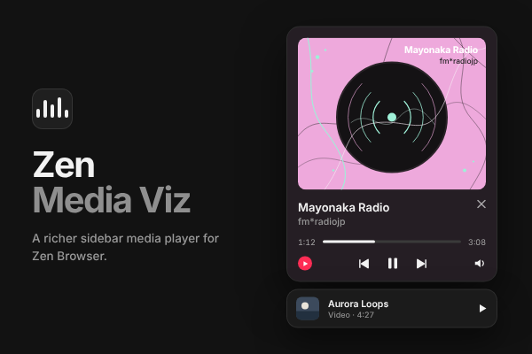

  

# Zen Media Viz

A mod for the [Zen Browser](https://zen-browser.app) that shows the artwork of whatever you're listening to in Zen's sidebar media player, such as songs on YouTube Music which it was honestly the reason why I built this I wanted to see some of the sick artworks of some songs while working on my browser, also I needed some context into what media tab I wanted to switch to and what works best than having a image to quickly decide.

https://github.com/user-attachments/assets/68f7e8ab-4f3a-414b-a75f-22cf61ced804

## Install

1. Install [Sine](https://github.com/CosmoCreeper/Sine).
2. In Zen, open Settings → Sine Mods, and in Sine's settings turn on installing JS from unofficial sources.

3. Paste https://github.com/rodzy/Zen-Media-Viz into the box under the marketplace, and you're all set.

## How it works

Websites report what's playing to the browser, often including album art. Zen's media player shows the title and artist but not the art. This mod is a small script, loaded by the [Sine](https://github.com/CosmoCreeper/Sine) mod manager, that reads the artwork for each playing tab and adds a thumbnail next to the title.

## Contributing

Contributions are welcome if you find something or want to add support to something that you'd like! Go ahead and open the PR. Read [CONTRIBUTING.md](CONTRIBUTING.md) to get set up. The project is built test-first, and every pull request runs the test suite in CI.

Please follow the [Code of Conduct](CODE_OF_CONDUCT.md), and report security problems privately as described in [SECURITY.md](SECURITY.md).

## License

[MIT](LICENSE)
